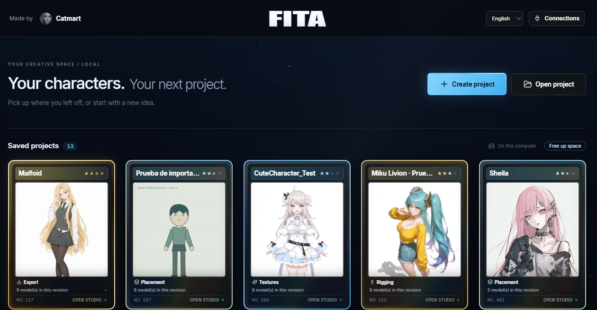
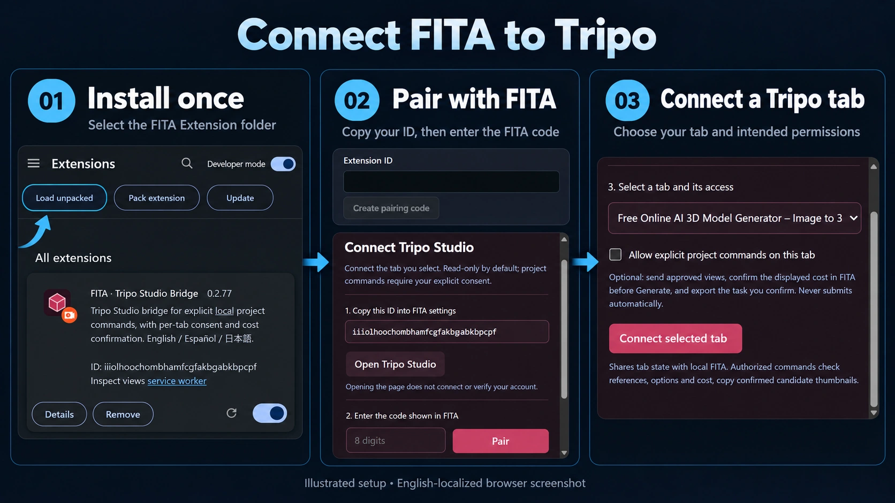
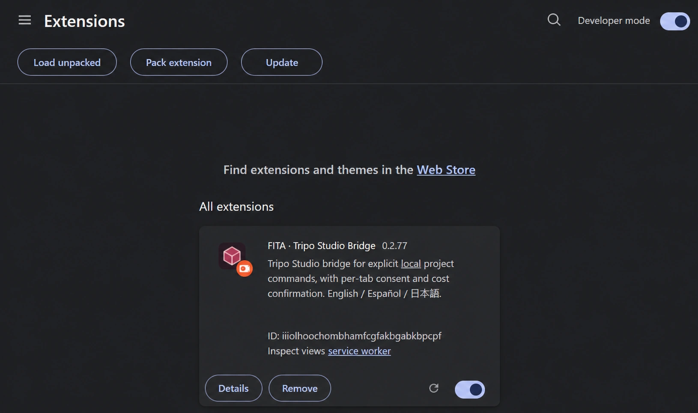
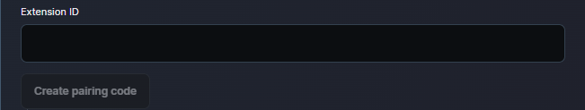
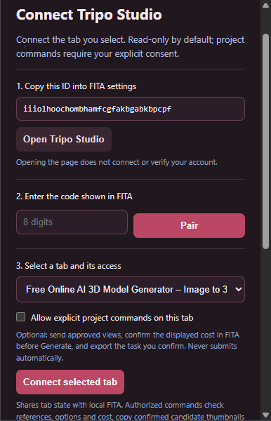
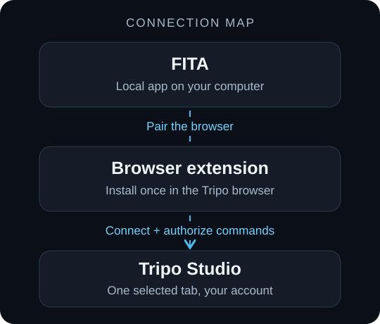

# Getting started with FITA

[README](https://github.com/catmart-xlvl/FITA#readme) · [Download Windows ZIP](https://github.com/catmart-xlvl/FITA/releases/latest/download/FITA-Windows-x64.zip) · [Detailed installation notes](../INSTALL.md)

For the complete end-user walkthrough, [download the illustrated Tutorial PDF](https://github.com/catmart-xlvl/FITA/raw/refs/heads/main/docs/FITA-Tutorial.pdf). It covers installation through export in 15 pages, with linked contents and no promotional cover.

## 1. Download and choose a location

Download **FITA-Windows-x64.zip** from the Release assets and extract it completely. Open the inner **FITA** folder. Choose a writable local folder you intend to keep before the first launch.

This is a file-layout diagram, not a screenshot:

```text
FITA/
├── Open FITA.cmd
├── Close FITA.cmd
├── Update FITA.cmd
├── FITA.ps1
├── FITA Extension/       ← select this folder in the browser
├── active.json
└── versions/
```

First launch creates persistent **user-data** and **runtime** folders. Keep them with the installation. Do not select a version-specific extension folder inside **versions**.

## 2. Open FITA

Double-click **Open FITA.cmd**. On the first launch, the setup window downloads required components and installs locked dependencies. Keep it open until setup finishes and FITA opens in your browser. Later starts reuse those components.

The local address is **http://127.0.0.1:4317**. If browser opening fails, use the URL shown by the launcher. An occupied port from another FITA installation must be resolved before opening a second copy.

Use **Create project** for a new reference or **Open project** to import a `.fita` backup.



*Card images include user-selected references and a separately labeled procedural demo. A thumbnail is not evidence of a finished generated avatar.*

## Connect the browser bridge

Install the included extension in the browser you use for **Tripo Studio**. FITA can be open in a different browser. Installation, browser pairing and tab connection are three distinct steps.



*ImageGen composition from supplied captures, including an English-localized browser screenshot. The readable individual controls appear below.*

### 3. Install the extension once

1. Open **chrome://extensions**, **edge://extensions** or **brave://extensions** in the browser address bar.
2. Enable **Developer mode**, then click **Load unpacked**.
3. Select **FITA Extension** beside **Open FITA.cmd** in the portable root folder.
4. Confirm **FITA · Tripo Studio Bridge** appears and is enabled. Open it from the browser toolbar's Extensions menu; pin it if convenient.



*English-localized screenshot edited with ImageGen. This capture shows version 0.2.77. Use your installed version and your own Extension ID.*

**Load unpacked** loads the included folder. You do not need **Pack extension**, a store upload or a `.crx` file. Keep the selected folder in place.

### 4. Pair the browser with FITA

1. Open **Connections** in FITA and **FITA · Tripo Studio Bridge** in the browser.
2. In the popup, copy the ID from **1. Copy this ID into FITA settings**.
3. Paste it into **Extension ID** in FITA, then click **Create pairing code**.
4. Enter the eight-digit code shown by FITA into **2. Enter the code shown in FITA** in the popup, then click **Pair**.



*Actual cropped form before an ID is entered. It is not a connected state. Private development paths and unrelated panels outside this crop are excluded.*

The button is disabled until a valid ID is entered. The code expires after **two minutes**; use **Create a new code** in FITA if necessary. Use your own ID and code, never an ID from documentation.

### 5. Connect the selected Tripo tab

1. Open **Tripo Studio** in this browser and sign in with your account.
2. In the popup's third step, choose the Studio tab you want FITA to use.
3. For the project workflow, check **Allow explicit project commands on this tab**. Leave it unchecked for read-only inspection.
4. Click **Connect selected tab**.



*Actual popup before connection: the code is empty and project commands are unchecked. A tab title is page content and can differ on your computer.*

Opening Studio alone does not connect it. Pairing alone does not select or authorize a tab. Command permission does not approve every generation cost; review the applicable price and confirmation in FITA before a paid operation.

### Check the connection

| FITA status | What to check |
| --- | --- |
| **Not connected** | Start pairing if this browser is not already remembered. |
| **Paired · waiting for tab** | Select an open Studio tab and use **Connect selected tab**. |
| **Connected · read only** | The selected tab can be inspected. Enable project commands and reconnect when you intend to use them. |
| **Connected · project commands** | Command access is available. Sign-in, pricing and each operation still have their own checks. |

Remembered browsers can reconnect after restarting FITA or the browser while their credentials remain valid. Routine reopening does not normally need a new code. Removing the extension, clearing its data, revoking access or invalid credentials can require pairing again.

Use **Disconnect and forget this browser** in FITA or **Revoke connection** in the popup only when you intend to revoke access. Preserve active tasks before changing connections. This is an independent integration, not an official Tripo extension.

<details>
<summary>How the app, extension and Studio fit together</summary>



The bridge uses local FITA on port 4317. OpenAI API and Advanced Tripo API settings are separate provider connections, not additional steps required to pair this browser bridge.

</details>

## 6. Start a project with your local agent

Use a reference you have the right to use. In **Concept**, confirm the reference and download the offered instruction ZIP. Attach it to your local coding agent and ask it to follow the instructions.

The package identifies the exact workspace and delivery helper. Automatic return needs an agent with access to that workspace. A cloud-only chat cannot be assumed to have it; use the stage's manual import alternative when needed.

FITA validates returns before dependent work unlocks. Review views, choose candidates, and review the complete UV/texturing plan at their checkpoints. In Textures, downloading an analysis ZIP starts a wait; it does not validate the analysis. **Cancel waiting** dismisses that local wait without canceling an external agent or approving a result.

## 7. Close, update and back up

- Finish active generation, transfers and agent work before closing or updating.
- **Close FITA.cmd** stops the local server; closing the browser tab does not.
- With FITA closed, **Update FITA.cmd** checks public stable releases and verifies a newer package before activation. Previous versions remain; projects stay in **user-data**.
- After updating, reload the existing extension when idle. Keep the same **FITA Extension** folder and do not remove it.
- Export `.fita` backups from the project library. To change location, install a fresh copy there and import the backups. Do not simply move or rename an installation after first launch.

## If something needs attention

| Symptom | Next step |
| --- | --- |
| First-run setup fails | Keep the error text; check internet access and a writable extracted folder. |
| No Studio tab listed | Open Studio in the same browser/profile, refresh popup status and select it. |
| A paid action times out | Retain the existing task and files. Inspect/recover it before approving another generation; a missing response does not prove it failed or was not charged. |
| Update blocked | Resolve the displayed active-work, local-edit, integrity or network issue. Do not remove saved projects to force it. |
| Installed folder moved | Restore the original path to export projects, then migrate using a fresh installation and verified `.fita` backups. |

[INSTALL.md](../INSTALL.md) contains the detailed launcher/storage contract. [LICENSE](../LICENSE) and [third-party notices](../THIRD_PARTY_NOTICES.md) apply to the software; other tools and services have their own terms and fees.
